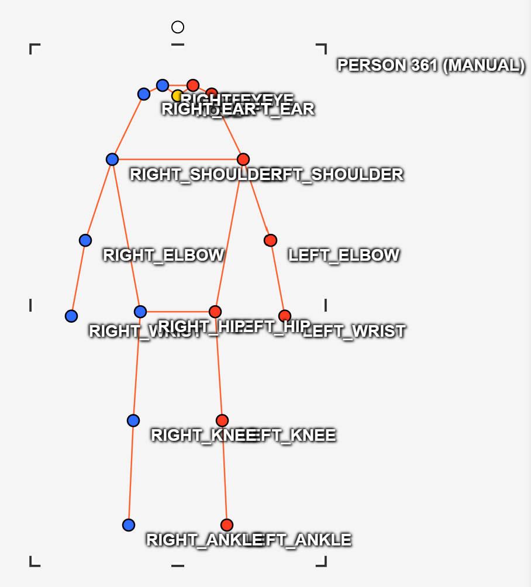
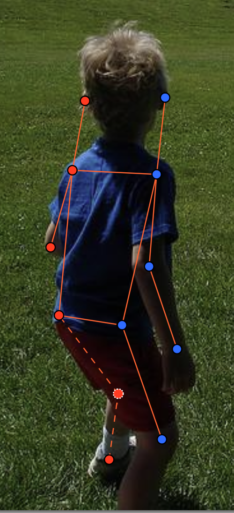
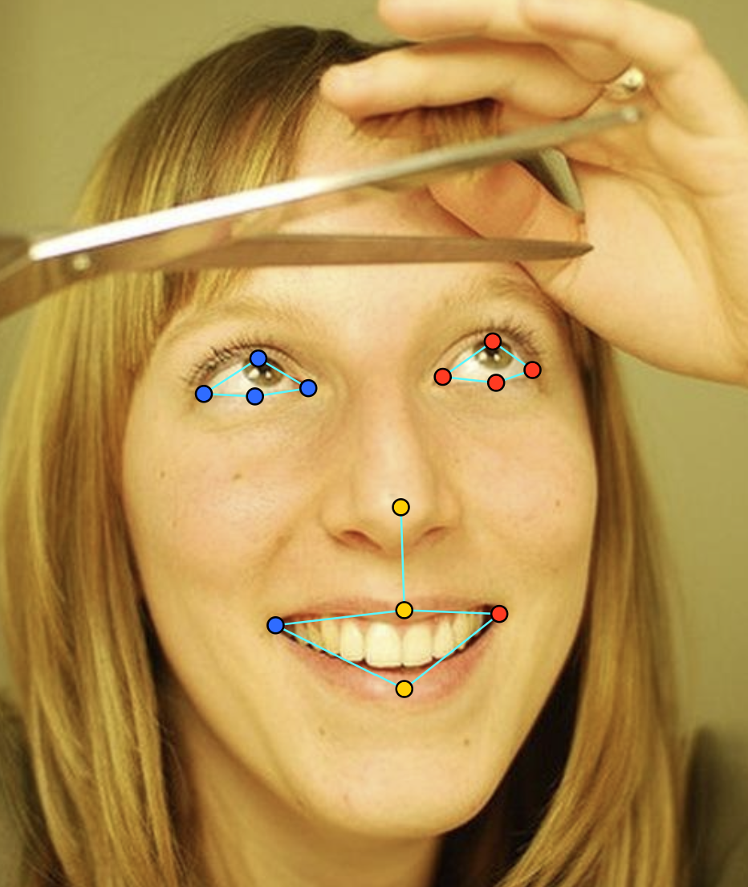
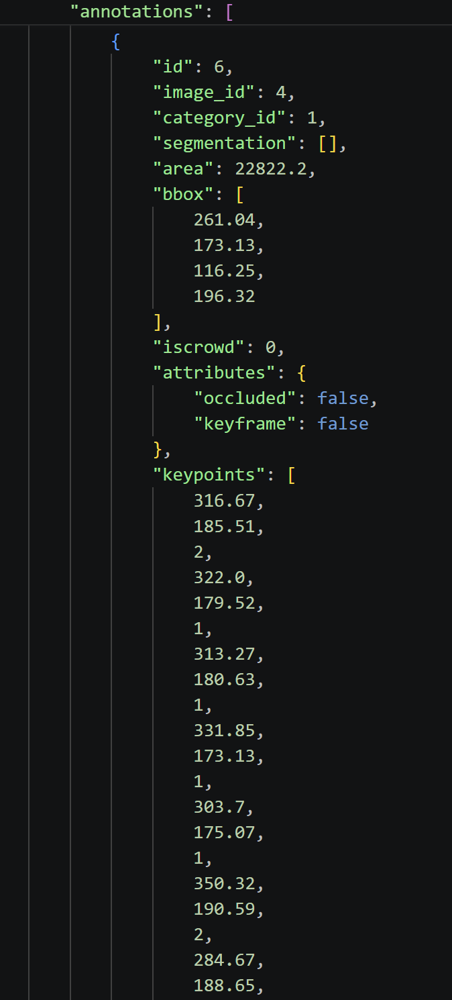

# Báo cáo cá nhân — NguyenQuangTung-2A202603080

Dữ liệu: 12 ảnh người COCO val2017 (Lin et al., 2014) và 8 ảnh chân dung Wikimedia Commons, chỉ dùng trong lớp.

## 0. Thông tin học viên

- Họ tên: Nguyễn Quang Tùng
- MSSV: 2A202603080
- Email: nguyenquangtung753@gmail.com
- Link repository: https://github.com/Nguyen-Quang-Tung-VN/K5-L2-DAY04-NguyenQuangTung-2A202603080-KeypointPose
- Phiên bản CVAT (Help → About): 2.74.1
- Máy: hệ điều hành Windows · RAM 16 GB (Docker cấp 7.6 GB RAM) · chạy CVAT chế độ đầy đủ
- Bộ ảnh (`src/exports/assignment.json` do `lab.py setup` tạo): có
- Giờ bắt đầu: 17:15
- Giờ kết thúc: 23:50

## 1. Kiểm tra label (CP0)

| Label | Kiểu | Số điểm | Tên điểm đúng bảng của lab? | Đúng thứ tự? | Số cạnh |
|---|---|---:|---|---|---:|
| `person` | Skeleton | 17 | Đúng | Đúng | 19 |
| `face` | Skeleton | 13 | Đúng | Đúng | 13 |

Mẫu `person` dựng theo người quay mặt về camera (các điểm `left_*` nằm bên phải khung mẫu)? Có

Cách đổi cờ `occluded` / `outside` cho **một điểm** trên phiên bản CVAT này (một câu):
Rê chuột vào điểm (điểm sáng lên), bấm phím `Q` để bật/tắt cờ `occluded` (v = 1), bấm phím `O` để bật/tắt cờ `outside` (v = 0), hoặc click chuột phải vào điểm để chọn trong menu 4 nút.

## 2. Số lượng đã gán và thời gian (CP1, CP2)

| Nhóm ảnh | Số ảnh | Số skeleton đã gán | Số người dưới 60 px (không gán) | Số poster / gương / màn hình bỏ qua | Thời gian (phút) |
|---|---:|---:|---:|---:|---:|
| `easy` | 5 | 5 | 0 | 0 | 25 |
| `occluded` | 3 | 7 | 0 | 0 | 35 |
| `back` | 2 | 4 | 0 | 0 | 25 |
| `small` | 1 | 2 | 1 | 0 | 15 |
| `crowd` | 1 | 2 | 3 | 0 | 20 |
| `faces` | 8 | 8 | — | 0 | 30 |

- Số ảnh người đã xong ở mốc phút 105: 10 / 10
- Thời gian thực tế (phút): CP1 115 · CP2 30 · CP3 20
- Ảnh tốn thời gian nhất là ảnh nào, vì sao?
Ảnh `000000469061.jpg` (nhóm occluded) tốn nhiều thời gian nhất vì ảnh chụp hai người đang trượt tuyết trên tuyết trắng chói lóa, trang phục mùa đông dày làm che khuất các khớp hông, gối, và người phía sau che lấp một phần người phía trước, đồng thời tư thế trượt nghiêng đòi hỏi phải phóng to để xác định chính xác chân nào ở gần (bên phải người trượt) và chân nào ở xa (bên trái người trượt).

## 3. Bảng ca khó (CP1, CP2)

Mỗi điểm bạn phân vân một dòng, nhất là phân vân giữa `v = 1` và `v = 0`, hoặc không chắc hướng người.

| Ảnh | Người / mặt | Điểm | Cờ đã chọn | Phân vân giữa | Lý do chọn |
|---|---|---|---:|---|---|
| `000000375535.jpg` | Cảnh sát mô tô #1 | `left_knee`, `left_ankle`, `right_knee`, `right_ankle` | 0 | v = 1 và v = 0 | Thân xe mô tô chắn kín toàn bộ chân người lái, không thể nhìn thấy vị trí khớp, không có căn cứ ước lượng chắc chắn nên chọn v = 0 (outside) để tránh đoán bừa gây sai lệch OKS. |
| `000000150192.jpg` | Người áo đỏ ngồi xa #2 | `left_hip`, `right_hip`, `left_knee`, `right_knee` | 0 | v = 1 và v = 0 | Bị mặt bàn và người ngồi đối diện che hoàn toàn từ bụng trở xuống, khoảng cách xa nên không đoán chắc vị trí khớp, chọn v = 0. |
| `face_324513.jpg` | Mặt nam đeo kính râm | 8 điểm vùng mắt (`left_eye_*`, `right_eye_*`) | 1 | v = 2 và v = 1 | Mắt bị mắt kính râm che khuất hoàn toàn (không nhìn thấy con ngươi), nhưng ước lượng chắc chắn được vị trí mắt dựa vào khung gọng kính, nên chọn v = 1 (occluded) theo đúng quy ước lab. |
| `000000469061.jpg` | Bé trượt tuyết áo xanh #2 | `left_shoulder` | 0 | v = 1 và v = 0 | Người nghiêng hẳn về bên phải, vai trái bị thân người và áo phao mùa đông dày che khuất hoàn toàn góc nhìn, chọn v = 0. |

## 4. Bảng tự review (CP3)

Đi từ ảnh cuối về ảnh đầu. 5 ảnh người (ít nhất 2 ảnh `back` hoặc `crowd`) và 3 ảnh mặt. Ít nhất 8 dòng, kể cả dòng `ok`. Ghi lỗi trước, sửa sau.

Mã lỗi dùng đúng một trong: `lr_swap`, `vis_flag`, `position`, `missing`, `extra`, `ok`.

| Ảnh | Người / mặt | Điểm | Mã lỗi | Ghi chú | Đã sửa? |
|---|---|---|---|---|---|
| `000000461002.jpg` | Bé chạy thả diều áo cam #2 | `left_hip`, `right_hip`, `left_knee`, `right_knee`, `left_ankle`, `right_ankle` | `lr_swap` | Bé chạy hướng trước-trái, phần thân trên gán đúng kiểu quay mặt nhưng phần chân lại gán theo kiểu quay lưng, làm chân bước tới (bên trái ảnh) bị nhầm thành chân trái. | Đã sửa |
| `000000469061.jpg` | Bé trượt tuyết áo xanh #2 | `left_knee`, `right_knee`, `left_ankle`, `right_ankle` | `lr_swap` | Bé nhìn nghiêng sang phải, chân gần người xem hơn (bên trái ảnh) là chân phải nhưng ban đầu gán nhầm thành chân trái, tạo đường nối chéo chữ X giữa hông và gối. | Đã sửa |
| `000000150192.jpg` | Người đàn ông áo ca rô #1 | `left_wrist`, `right_wrist` | `vis_flag` | Cổ tay bị mép bàn và ly nước PDQ che khuất một phần, ban đầu để v = 2, đã sửa sang v = 1 (occluded) vì bị che nhưng ước lượng chắc chắn được. | Đã sửa |
| `000000072098.jpg` | Người trượt ván #1 | Toàn bộ 17 điểm | `ok` | Hướng người quay mặt về phía camera, các khớp đầu, vai, hông, gối, chân đặt chính xác, không nhầm trái/phải. | Đã sửa |
| `000000307757.jpg` | Hai người quay lưng #1 & #2 | Toàn bộ 17 điểm | `ok` | Người quay lưng chuẩn, các điểm `left_*` nằm ở bên trái ảnh, đường nối xương vai-hông song song chuẩn. | Đã sửa |
| `face_324513.jpg` | Khuôn mặt đeo kính râm | 8 điểm mí và khóe mắt hai bên | `vis_flag` | Ban đầu để v = 2, đã đổi toàn bộ 8 điểm mắt sang v = 1 (occluded) theo gọng kính râm chuẩn quy ước của lab. | Đã sửa |
| `face_125051.jpg` | Khuôn mặt thẳng #1 | Toàn bộ 13 điểm | `ok` | Khóe mắt trong/ngoài, mí trên/dưới đặt sát mép con ngươi, khóe miệng và chóp mũi đặt chính xác. | Đã sửa |
| `face_232598.jpg` | Khuôn mặt hơi nghiêng #2 | `nose_tip`, khóe miệng | `position` | Chóp mũi hơi lệch nhẹ sang bên cánh mũi, đã căn chỉnh lại chính xác vào tâm chóp mũi. | Đã sửa |

Tổng hợp số lỗi theo mã:

| `lr_swap` | `vis_flag` | `position` | `missing` | `extra` | `ok` |
|---:|---:|---:|---:|---:|---:|
| 2 | 2 | 1 | 0 | 0 | 3 |

Điểm còn phân vân giữa `v = 1` và `v = 0` (ghi cả hai lựa chọn và lý do chọn):
Tại ảnh `000000375535.jpg` (2 người lái mô tô), các khớp chân (`knee`, `ankle`) nằm ẩn sau vỏ xe bằng nhựa đặc. Lựa chọn 1 là đặt `v = 1` với giả định tư thế ngồi gác chân lên bàn đạp xe máy; Lựa chọn 2 là đặt `v = 0` (outside/che hoàn toàn không nhìn thấy). Quyết định chọn `v = 0` vì không thể nhìn thấy bất kỳ đường nét nào của cẳng chân/bàn chân, việc đặt tọa độ suy đoán có nguy cơ gây sai số lớn (>10-20 px), làm giảm điểm OKS và khiến model học theo vị trí đoán bừa.

## 5. Kiểm file xuất và kết quả tự kiểm (CP4)

Tự kiểm tay trong file JSON:

| File | Người / mặt kiểm (ảnh, thứ tự) | Số phần tử `keypoints` | Điểm `outside` ra `v = 0`, `occluded` ra `v = 1`? | `num_keypoints` khớp? |
|---|---|---:|---|---|
| `NguyenQuangTung_persons.zip` | 000000072098.jpg #1 | 51 | Đúng (đủ v=2 và v=1) | Khớp (17/17) |
| `NguyenQuangTung_persons.zip` | 000000150192.jpg #1 | 51 | Đúng (chân v=0 ra tọa độ cũ, v=0) | Khớp (11/17) |
| `NguyenQuangTung_faces.zip` | face_125051.jpg #1 | 39 | Đúng (13 điểm đều v=2) | Khớp (13/13) |

Sau khi xuất, CVAT ghi `occluded` thành `v = 1` và `outside` thành `v = 0`. Tọa độ của điểm `outside` trong file là tọa độ cũ (chuẩn COCO gốc quy định 0, 0 nhưng CVAT 2.x giữ nguyên tọa độ cũ và gắn nhãn v = 0, điểm này sẽ bị bỏ qua khi tính loss và chấm điểm).

Hai job đã chuyển sang completed trên CVAT? Có

Dán phần **TÓM TẮT** in ra từ `src/check_submission.py`:

```text
- File person: NguyenQuangTung_persons.zip
  Số ảnh: 12 · số skeleton `person`: 20 · mỗi annotation 51 số
  Skeleton theo ảnh: 000000072098=1, 000000091637=2, 000000103970=1, 000000130816=2, 000000150192=2, 000000176000=1, 000000295358=1, 000000307757=2, 000000375535=3, 000000461002=2, 000000469061=2, 000000564304=1
  Cờ v: v=2 222 (65%) · v=1 39 (11%) · v=0 79 (23%)
  num_keypoints trung bình: 13.1
- File face: NguyenQuangTung_faces.zip
  Số ảnh: 8 · số skeleton `face`: 8 · mỗi annotation 39 số
  Skeleton theo ảnh: face_125051=1, face_232598=1, face_264124=1, face_324513=1, face_356144=1, face_421231=1, face_490361=1, face_514826=1
  Cờ v: v=2 96 (92%) · v=1 8 (8%) · v=0 0 (0%)
  num_keypoints trung bình: 13.0
- Ghi chú: 79 điểm v = 0 vẫn mang tọa độ cũ (CVAT 2.x xuất như vậy; chuẩn COCO ghi 0, 0). Không phải lỗi: điểm v = 0 bị bỏ qua khi huấn luyện và khi chấm.
- Số [LỖI]: 0 · số [CẢNH BÁO]: 3
Kết quả: ĐẠT
```

Các `[CẢNH BÁO]` còn giữ nguyên và lý do:
1. `000000150192.jpg #2`: Người đàn ông ngồi ở bàn xa, các điểm chỉ trải cao 42 px do bị bàn ghế và người ngồi trước che khuất phần dưới cơ thể. Đây là người thật có kích thước lớn hơn 60 px nhưng bị cắt khung nhìn, theo hướng dẫn của script tự kiểm tra thì trường hợp này hợp lệ được giữ nguyên.
2. `000000375535.jpg #1` (39 px) và `#3` (52 px): Hai cảnh sát đang điều khiển xe mô tô tuần tra. Độ trải điểm chiều cao nhỏ hơn 60 px vì thân xe mô tô che lấp toàn bộ nửa dưới cơ thể. Đây là người lớn lái xe (thuộc nhóm ảnh occluded), người thật lớn hơn 60 px nhưng bị che khuất cơ học, hoàn toàn hợp lệ giữ nguyên skeleton.

## 6. Ảnh chụp màn hình

1. Label `person` trong label constructor (đủ 17 điểm có tên):

   

2. Một người quay lưng đã gán, cờ đã đặt:

   

3. Một khuôn mặt đã gán 13 điểm, phóng to vùng mắt:

   

4. Một đoạn JSON xuất của một người:

   

Nguồn ảnh: COCO val2017 / Wikimedia Commons.

## 7. Tự đánh giá

1. Lỗi bạn mắc nhiều nhất hôm nay, và cách bạn sẽ tránh ở dự án thật:
Lỗi dễ mắc nhất là nhầm lẫn trái/phải (`lr_swap`) ở các tư thế người chuyển động phức tạp (như đứa bé chạy nghiêng, hoặc bé trượt tuyết). Khi nhìn nhanh, mắt người xem rất dễ gán nhầm bên trái ảnh thành bên trái người. Cách tránh ở dự án thật: Luôn luôn tuân thủ nguyên tắc "Xác định hướng người trước khi kéo điểm", nhìn theo góc nhìn của người trong ảnh (ego-centric), và quan sát kỹ các đường nối xương (skeletal links) — nếu hai chân hoặc hai tay bắt chéo nhau bất thường thì ngay lập tức phải kiểm tra lại nhãn trái/phải.

2. Một quy tắc bạn đề xuất thêm vào guideline (kèm ảnh ví dụ nếu có):
Đề xuất thêm quy tắc rõ ràng cho "Vật thể bị che khuất bởi phương tiện giao thông (xe máy, xe đạp, ô tô)": Khi người ngồi trên phương tiện và toàn bộ phần cẳng chân, bàn chân bị che kín bởi thân vỏ kim loại/nhựa đặc mà không có bóng dáng lộ ra, bắt buộc phải đánh dấu `outside` (v = 0) cho gối và cổ chân, tuyệt đối không cho phép gán `occluded` (v = 1) theo phán đoán, nhằm tránh tình trạng gán điểm ảo làm giảm độ tin cậy của ground truth khi huấn luyện model pose.

3. Nhãn của bạn đi vào model ở đâu? Chọn một lỗi bạn đã sửa và nói nó sẽ làm model học sai thế nào (heatmap, trọng số trong loss, hay bước lật ảnh):
Trong các mạng Pose Estimation hiện đại (như HRNet, SimpleBaseline), nhãn keypoint được dùng để tạo các bản đồ nhiệt Gaussian (heatmaps) 2D với tâm tại tọa độ `(x, y)` cho mỗi khớp; cờ visibility $v$ quyết định trọng số mask trong hàm mất mát (loss function): điểm $v > 0$ có trọng số là 1 (tính loss), $v = 0$ có trọng số là 0 (bỏ qua loss).
Nếu để sót lỗi `lr_swap` (ví dụ ở ảnh bé trượt tuyết `000000469061.jpg`):
- Trong quá trình huấn luyện, bước tăng cường dữ liệu lật ảnh ngang (Random Horizontal Flip) sẽ lật ảnh đối xứng và tự động hoán đổi nhãn `left_*` $\leftrightarrow$ `right_*`.
- Nếu nhãn ban đầu đã bị đảo `lr_swap`, sau khi lật ảnh nó sẽ tạo ra hai nhãn mâu thuẫn trực tiếp cho cùng một đặc trưng thị giác.
- Hậu quả là hàm loss sẽ kéo gradient về hai hướng đối nghịch nhau tại hai vị trí khớp khác nhau, làm phân tán đỉnh heatmap (tạo ra hiện tượng phân phối lưỡng cực - bimodal heatmap) và khiến model không thể hội tụ chính xác, dẫn đến việc model dự đoán nhầm chân trái thành chân phải khi inference ngoài đời thực.

## 8. Khó khăn và lỗi kỹ thuật

- Thao tác trên CVAT với các điểm skeleton ở độ phân giải lớn đôi khi khó bắt đúng điểm mong muốn khi các khớp nằm sát nhau (như mắt và tai của người ở xa). Khắc phục bằng cách phóng to tối đa (zoom in) và sử dụng phím tắt chuyển điểm.
- Quy ước về cờ `v = 1` và `v = 0` cần sự cân nhắc kỹ lưỡng giữa việc "giúp model học khớp bị che" và "tránh đưa vào dữ liệu đoán bừa không chắc chắn".

## Bonus (nếu làm)

### B1 — 3 ảnh người khó thêm

| Ảnh | Số skeleton | Số người dưới 60 px | Ca khó nhất |
|---|---:|---:|---|
| | | | |
| | | | |
| | | | |

Kết quả `src/check_submission.py` cho `NguyenQuangTung_bonus_persons.zip`:

```text
(dán ở đây)
```

### B2 — 5 ảnh khuôn mặt đen trắng / hồng ngoại

Ảnh không màu khó hơn ở điểm nào? Kính râm trên ảnh hồng ngoại có còn là `v = 1` không?

...

### B3 — Model so với nhãn của tôi (không tính điểm)

- Demo đã dùng:
- Ảnh đã thử:

1. Model có trả điểm cho khớp bị che, hay khớp ngoài ảnh không? Confidence ở các điểm đó thế nào?

   ...

2. Với người quay lưng, model có đổi trái/phải không?

   ...

3. Bộ điểm của model có giống 17 điểm COCO không?

   ...

## 9. Tài liệu tham khảo và công cụ AI đã dùng

- Trợ lý AI Antigravity: Tra cứu lý thuyết COCO Keypoints, công thức OKS, cơ chế heatmap và loss trong mô hình pose estimation; hỗ trợ rà soát kiểm tra tính nhất quán trái/phải trên tập dữ liệu và định dạng báo cáo.
- Tài liệu COCO Dataset (Lin et al., 2014) và CVAT Documentation.
